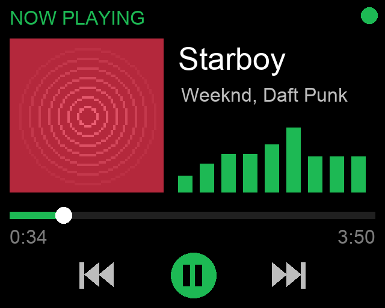
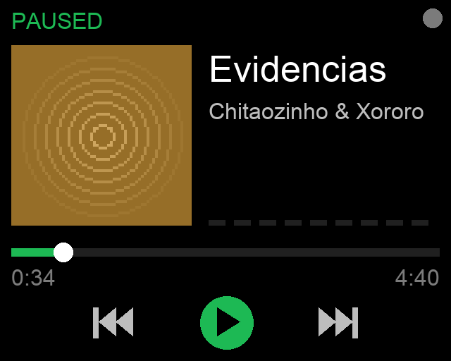

# Spotify Now Playing - chaveiro com ESP32-C3

Mini player do Spotify em formato de chaveiro: mostra a música que está tocando no celular, com capa do álbum, nome rolando, equalizador animado, barra de progresso e 3 botões para voltar, pausar e pular. Funciona com bateria própria.

> Spotify "Now Playing" keychain built with an ESP32-C3 Super Mini and a 1.8" ST7735 TFT (160x128), with album art, marquee text, progress bar and physical playback buttons. Fork of [jnrtxr/spotify-esp32](https://github.com/jnrtxr/spotify-esp32), adapted from the ESP32-2432S028R (CYD) to the C3 + ST7735.

| Tocando | Pausado |
| :---: | :---: |
|  |  |

*Imagens do simulador incluído no projeto (`tools/display_simulator.py`).*

## Hardware

| Peça | Observação |
| :--- | :--- |
| ESP32-C3 Super Mini | Wi-Fi, USB-C, 4 MB de flash |
| Display TFT 1.8" SPI ST7735 128x160 | Módulo de 8 pinos |
| 3 botões táteis 6x6 mm | Anterior, play/pause, próxima |
| Módulo carregador TP4056 USB-C com proteção | Carrega a bateria |
| Bateria Li-Po 3,7 V 400 mAh (602035 ou 702030) | Com proteção (PCM) |
| Chave deslizante SS12D00G3 | Liga e desliga |
| Placa perfurada 5x7 cm, fios 24 AWG | Montagem |

## Ligações

### Display

| Display | ESP32-C3 |
| :--- | :--- |
| VCC | 3V3 |
| GND | GND |
| SCK / SCL | GPIO4 |
| SDA / MOSI | GPIO6 |
| CS | GPIO7 |
| A0 / DC / RS | GPIO3 |
| RESET / RES | GPIO10 |
| LED / BL | GPIO5 |

Os nomes SCL e SDA no módulo enganam: a tela é SPI, não I2C.

### Botões

Cada botão tem um lado no GPIO e o outro no GND. Não precisa de resistor, porque o código liga o pull-up interno.

| Botão | ESP32-C3 |
| :--- | :--- |
| Anterior | GPIO0 |
| Play / pause | GPIO1 |
| Próxima | GPIO20 |

Os pinos GPIO2, GPIO8 e GPIO9 controlam o boot do C3 e ficam livres. O GPIO8 é o LED azul da placa, que acende enquanto a música toca.

### Bateria

```
Bateria +  -> TP4056 B+
Bateria -  -> TP4056 B-
TP4056 OUT+ -> chave -> ESP32-C3 5V
TP4056 OUT- -> ESP32-C3 GND
```

- Confira a polaridade da bateria antes de soldar. Inverter queima o TP4056.
- Desligue a chave antes de gravar o código pela USB da ESP32.
- Para carregar, use a porta USB-C do TP4056. O LED vermelho indica carga e o verde, carga completa.

## Configuração

### 1. App no Spotify

1. Acesse o [painel de desenvolvedor do Spotify](https://developer.spotify.com/dashboard) e crie um app.
2. Em Settings, adicione o Redirect URI `http://127.0.0.1:8888/callback`.
3. Copie o Client ID e o Client Secret.

Os botões usam a API de controle do player, que exige conta Premium. Quando a conta não tem permissão, a tela avisa "Precisa Spotify Premium". Confira também as regras atuais do modo de desenvolvedor no painel do Spotify, que podem exigir Premium na conta dona do app.

### 2. Refresh token (uma vez, no computador)

```bash
cd tools
pip install -r requirements.txt
export SPOTIFY_CLIENT_ID=seu_client_id
export SPOTIFY_CLIENT_SECRET=seu_client_secret
python get_refresh_token.py
```

O navegador abre o login do Spotify. No fim, o script mostra o comando `SET_CREDS:...` pronto para copiar.

### 3. Gravar o firmware

```bash
pip install platformio
pio run -t upload
```

Se a placa não aparecer, segure o botão BOOT, aperte RESET e solte o BOOT. Isso coloca o C3 em modo de gravação.

### 4. Enviar as credenciais

```bash
pio device monitor
```

Cole o comando gerado no passo 2 e aperte Enter:

```
SET_CREDS:client_id:client_secret:refresh_token
```

As credenciais ficam na memória da placa e sobrevivem a reinícios.

### 5. Wi-Fi

Na primeira vez, a placa cria a rede `SpotifyDisplay-Setup`. Conecte pelo celular, escolha o seu Wi-Fi e digite a senha. A placa salva e reinicia conectada.

## Uso

- A tela atualiza a cada 4 segundos. A barra de progresso avança sozinha entre as consultas.
- Os botões controlam o aparelho que está tocando o Spotify, como o celular.
- Depois de 2 minutos sem música tocando, a tela apaga para poupar bateria. Qualquer botão acende de novo.
- Com a bateria de 400 mAh, a autonomia estimada é de 3 a 4 horas com a tela ligada.

### Comandos pela USB

| Comando | O que faz |
| :--- | :--- |
| `SET_CREDS:id:secret:token` | Grava as credenciais do Spotify |
| `RESET_WIFI` | Apaga o Wi-Fi salvo e reabre o portal |
| `STATUS` | Mostra estado, sinal do Wi-Fi e memória livre |

## Simulador

Para ver o layout no computador, sem a placa:

```bash
cd tools
python display_simulator.py --demo
```

No modo demo, espaço pausa e as setas trocam de música. Sem `--demo`, o simulador lê o Spotify de verdade usando `tools/.env` (veja `tools/.env.example`).

No macOS com Python do Homebrew, o Tkinter vem separado. Instale com `brew install python-tk`.

## Simulação no Wokwi

O projeto roda no [Wokwi](https://wokwi.com), sem a placa, pelo VS Code:

1. Instale as extensões **PlatformIO IDE** e **Wokwi Simulator** no VS Code e ative a licença gratuita do Wokwi (`F1` > `Wokwi: Request a New License`).
2. Compile o ambiente do simulador: `pio run -e wokwi`.
3. Abra o `diagram.json` e aperte play.
4. No terminal serial do Wokwi, cole o `SET_CREDS:...`. O Wi-Fi conecta sozinho na rede simulada `Wokwi-GUEST`.

O Wokwi não tem o display ST7735, então a simulação usa o ILI9341 com os mesmos pinos. A interface aparece no canto superior esquerdo da tela.

## Ajustes

- **Cores ou bordas erradas na tela:** troque `-DST7735_BLACKTAB=1` no `platformio.ini` por `ST7735_GREENTAB`, `ST7735_GREENTAB2` ou `ST7735_REDTAB`.
- **Tela de cabeça para baixo:** mude `DISPLAY_ROTATION` de 1 para 3 em `include/display_driver.h`.
- **Outros pinos:** todos ficam nos `build_flags` do `platformio.ini`.
- **Layout:** posições e tamanhos ficam em `include/ui_renderer.h`.

## Estrutura

```
├── platformio.ini            # placa, pinos e bibliotecas
├── include/ e src/
│   ├── main.cpp              # máquina de estados, botões e economia de bateria
│   ├── display_driver        # ST7735 via TFT_eSPI
│   ├── ui_renderer           # layout 160x128, marquee, equalizador
│   ├── spotify_auth          # renovação do token (OAuth)
│   ├── spotify_poller        # consulta da música atual e da capa
│   ├── spotify_control       # play, pause, próxima e anterior
│   ├── buttons               # leitura dos botões com debounce
│   ├── json_parser           # parse com filtro (pouca RAM)
│   └── wifi_manager_setup    # portal cativo do Wi-Fi
├── tools/
│   ├── get_refresh_token.py  # login OAuth no computador
│   ├── display_simulator.py  # simulador da tela
│   └── test_api.py           # teste da API no terminal
└── docs/                     # imagens do README
```

## Bibliotecas

- [TFT_eSPI](https://github.com/Bodmer/TFT_eSPI): driver do display
- [TJpg_Decoder](https://github.com/Bodmer/TJpg_Decoder): decodificador JPEG da capa
- [ArduinoJson](https://arduinojson.org/): parse da resposta da API
- [WiFiManager](https://github.com/tzapu/WiFiManager): portal de configuração do Wi-Fi

## Créditos

Baseado no projeto [jnrtxr/spotify-esp32](https://github.com/jnrtxr/spotify-esp32), de Junior Silva, publicado sob a licença MIT. Esta versão adapta o firmware para a ESP32-C3 com display ST7735, refaz o layout para 160x128 e adiciona botões físicos, alimentação por bateria e o modo demo do simulador.
